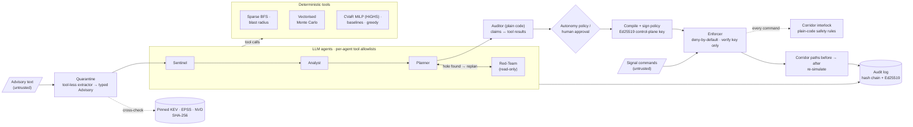

<div align="center">

# 🛡️ UrbanShield

### A cyber resilience control plane for connected cities: plan for the bad year, enforce the fix, prove it worked.

[](https://github.com/Mohammed-Rayan07/urbanshield/actions/workflows/ci.yml)


**ChronoForge 2026 · NITK Surathkal · Cybersecurity track · *Cities of the Future* · Team Merge Conflict**

[How it works](#-how-it-works) · [Results](#-results) · [Security model](#-security-model) · [Quick start](#-quick-start) · [Architecture](docs/ARCHITECTURE.md) · [Evaluations](docs/EVALS.md)

</div>

---

## The problem

Cities are connecting traffic signals, smart meters, streetlights and EV chargers faster than they can secure
them. Their security teams get a scanner report sorted by CVSS. That report never tells them **which few
devices to fix with the money and maintenance window they actually have**, and it never fixes anything.

Ranking by severity also targets the wrong thing. A city doesn't fear the average year. It fears the **bad
year**: one cheap, widely exploited bug that spreads through a shared management network into the
ambulance-corridor signals.

## What UrbanShield does

UrbanShield is a working **detect → decide → enforce → verify** loop over a digital twin of a city:

> An advisory arrives → four AI agents assess it, trace the attack paths, plan the fix and attack their own
> plan → a human approves anything risky → the plan becomes **signed network policy** on a deny-by-default
> gateway → the system **re-simulates** to prove the risk dropped → every step lands in a **tamper-evident,
> signed audit log**.

<table>
<tr>
<td width="50%" valign="top">

### 📉 Optimises for the worst case, not the average
A **CVaR (Conditional Value-at-Risk) MILP** chooses controls that minimise the average loss over the worst 5%
of 2,000 simulated attack scenarios, within a ₹ budget and a downtime window.

</td>
<td width="50%" valign="top">

### 🤖 Agents decide, deterministic tools compute
Four LLM agents choose *what to investigate and try*. Every number comes from a tool call with an ID, and a
**plain-code Auditor** rejects any claim that doesn't match a recorded tool result.

</td>
</tr>
<tr>
<td valign="top">

### 🔐 Plans become enforced, signed policy
Approved controls compile into concrete rules signed with a **separate Ed25519 control-plane key**. The
Enforcer refuses bad signatures, another city's policy and rollbacks, then **checks for itself** that the
corridor paths went from *open* to *closed*.

</td>
<td valign="top">

### 🚦 A safety interlock no LLM can bypass
Every traffic-signal command passes a deterministic **corridor interlock**: no conflicting greens, a limit
on remote holds, and the corridor must stay passable. It judges the **command, not the login**, so it holds
even against stolen credentials.

</td>
</tr>
<tr>
<td valign="top">

### 🧪 Untrusted text is quarantined
Advisory bulletins can carry prompt injections. A **tool-less extractor** reduces them to a typed
`Advisory`, which is cross-checked against a **SHA-256-pinned CISA KEV / EPSS / NVD snapshot** and the city
inventory before any planner sees it.

</td>
<td valign="top">

### 🧾 Every action is provable
Events, policy decisions and interlock verdicts go into a **SHA-256 hash-chained, Ed25519-signed audit
log**. Change one row and verification breaks at exactly that entry, which you can try live in Judge Mode.

</td>
</tr>
</table>

---

## 📊 Results

Every plan gets the **same ₹1,50,000 budget and 24-hour downtime limit**. Each is scored on **2,000 held-out
attack scenarios** that the optimiser never saw. CVaR95 is the average simulated loss in the worst 5% of
scenarios; lower is better.

| Planner | Worst-case loss (CVaR95) | 95% bootstrap CI | UrbanShield's CVaR is |
|---|---:|---|---:|
| **UrbanShield CVaR MILP** | **6.34** | [5.84, 6.82] | — |
| Patch by CVSS score | 17.12 | [16.62, 17.67] | **63% lower** |
| CVSS + KEV + EPSS ranking | 15.85 | [15.40, 16.33] | **60% lower** |
| BFS reach-centrality ranking (graph-only) | 15.11 | [14.50, 15.77] | **58% lower** |
| Patch-only MILP (ablation) | 9.27 | [8.57, 9.97] | **32% lower** |
| Mean-loss MILP (ablation) | 7.78 | [6.88, 8.68] | **19% lower** |

- **It does more with less money.** At ₹1.5 L UrbanShield's worst case is 6.34. CVSS-first given four times
  the money (₹6 L) still reaches only 12.61. Even at **₹50,000**, UrbanShield (10.82) beats CVSS-first at
  ₹6 L. This comes from the budget frontier in [`backend/fixtures/frontier.json`](backend/fixtures/frontier.json).
- **The result holds across cities.** It beats both CVSS-first and BFS-only in **5 of 5** perturbed cities
  (costs and criticality ±20%). Every seed is reported, including the weakest.
- **Same attack, two cities.** One held-out worst-5% attack, replayed with identical random draws:
  CVSS-first loses **23 devices and an ambulance-corridor signal**, while UrbanShield loses **one** and the
  corridor stays clear.
- **It enforces the fix.** A live Lumenos incident ends with *"Enforced signed policy v1 (64 rules, 0.5 ms):
  corridor paths open → closed"*, and re-simulated CVaR95 falls from **18.80 → 13.98**. In the attack console,
  a kill chain sent with stolen credentials is blocked **3 of 3**.
- **It scales.** It plans a **5,000-device** city (17,483 control options): Monte Carlo takes 1.0 s and the
  MILP stops at its 30 s limit, keeping its best plan so far (CVaR 205.79 vs 212.32 for the greedy fallback).

<p align="center"></p>

Full tables, methods and caveats are in [**docs/EVALS.md**](docs/EVALS.md). All of them are generated by
scripts, not typed by hand. These are simulated losses for a synthetic city, not real incident rates.

---

## 🔁 How it works



### The four agents

The LLM decides what to look at and what to try. It never applies a control, signs a policy or overrides the
interlock.

| Agent | Job | Tools it may call (allowlist) |
|---|---|---|
| **Sentinel** | Turns an untrusted advisory into a verified, typed finding and matches it to affected devices | `quarantine_extract`, `cross_check`, `match_inventory` |
| **Analyst** | Traces attack paths and blast radius, including reach into the ambulance corridor | `bfs_reach`, `blast_radius`, `simulate`, `query_devices` |
| **Planner** | Turns plain-language constraints into a budget-optimal plan and compares it with the baselines | `parse_constraint`, `optimize`, `compare`, `plan_diff` |
| **Red-Team** | Attacks the chosen plan with adaptive strategies; a material CVaR increase forces a replan | `simulate_strategy`, `bfs_reach`, `list_controls` (read-only) |

A call outside an agent's allowlist is refused and audited; the tool never runs. The deterministic
**Auditor** then checks every numeric claim against the recorded tool results. Low-risk controls with no
downtime apply automatically; anything with downtime waits for a human approver.

### The deterministic core

| Layer | What it does | Engineering |
|---|---|---|
| **City twin** | 50-device Mangaluru twin: traffic signals along an NH-66 ambulance corridor, meters, streetlights, EV-charger gateways | Deterministic generator; same seed gives a byte-identical city |
| **Vulnerability feed** | 40 real CISA KEV entries from 18 IoT/OT vendors, with EPSS and CVSS | Pinned by SHA-256 (sidecar *and* in-code pin); missing or altered feed fails closed |
| **Graphs** | `REACH` (attack movement) and `DEPENDS` (service dependency) | `scipy.sparse.csgraph` multi-source BFS; reach centrality via strongly connected components (34.5 s → 22 ms at 5,000 devices) |
| **Simulator** | Monte Carlo attack spread with correlated campaigns and attacker strategies | NumPy arrays (scenarios × devices), common random numbers, checked against a naive reference implementation |
| **Optimiser** | CVaR95 MILP (Rockafellar–Uryasev) under budget, downtime and policy constraints | SciPy/HiGHS; option savings calibrated in the simulator; greedy warm start and automatic MILP → greedy fallback |
| **Enforcer** | Compiles controls into `deny_flow`, `close_management`, `rotate_credentials`, `schedule_firmware`, `filter_cve` rules | Signed, versioned, city-scoped policy; checks corridor reachability on its own flow table |
| **Audit log** | Records every event, decision and verdict | SQLite, SHA-256 chain, Ed25519 signatures, `BEGIN IMMEDIATE` writes; verify reports the exact broken entry and detects truncation |

---

## 🔒 Security model

UrbanShield is designed against the **OWASP Top 10 for LLM Applications** and against a compromised operator.

| Threat | Control |
|---|---|
| **LLM01 Prompt injection** | Quarantine, typed extraction, feed + inventory cross-check, no state-changing fields |
| **LLM05 Improper output handling** | Pydantic v2 validation at every tool boundary; numbers come only from tools |
| **LLM06 Excessive agency** | Per-agent allowlists, read-only Red-Team, human approval for anything with downtime, no API route that pushes policy |
| **LLM09 Misinformation** | A plain-code Auditor rejects ungrounded claims |
| **Stolen operator credentials** | The corridor interlock vetoes unsafe signal commands whoever sends them; closed management refuses remote commands |
| **Rogue or replayed policy** | Separate control-plane signing key; the gateway holds only the verify key; older versions are refused |
| **Data poisoning** | Feed snapshot pinned by SHA-256 and refused if changed |
| **Tampering / repudiation** | Hash-chained, signed audit log with a verify endpoint |

The committed injection suite has **50 variants**: 36 poisoned advisories and 14 that are valid-looking
but wrong, such as a downgraded CVSS, a swapped vendor or a narrowed version range.

---

## 🖥️ The dashboard

| Workspace | What you see |
|---|---|
| **Story Mode** `#/story` | A five-slide guided pitch built on live data: problem → two cities → mitigation → proof → trust |
| **Overview** | *Same Attack, Two Cities*: one worst-case attack replayed hop by hop on two Leaflet maps |
| **Risk Intelligence** | Plan comparison, held-out risk, and a budget-frontier slider (₹50 k → ₹6 L) |
| **Response & Mitigation** | Agents streaming over SSE, hold-to-approve, and a live attack console against the Enforcer |
| **Devices** | Sortable inventory: firmware, CVSS, EPSS, criticality, each device's share of the worst-case loss, and UrbanShield's chosen control |
| **Judge Mode** | Load a poisoned or wrong advisory and see what reaches the planner; tamper with the log and verify |
| **Audit Log** | The signed chain with per-entry verification |

---

## 🚀 Quick start

Requirements: Python 3.12 with [`uv`](https://docs.astral.sh/uv/), and Node.js with npm. No API key is needed:
the default `mock` mode runs fully offline.

```bash
# Terminal 1: backend
cd backend
uv sync
uv run uvicorn urbanshield.api.main:app --reload --port 8000
```

```bash
# Terminal 2: frontend
cd frontend
npm ci
npm run dev
```

Open **<http://localhost:5173>** (start with `#/story`). The API docs are at <http://localhost:8000/docs>.

**Docker:** copy `.env.example` to `.env`, keep `LLM_MODE=mock`, then run:

```bash
docker compose up --build
```

### LLM modes

| Mode | Use | Notes |
|---|---|---|
| `mock` | Default, CI, offline | Deterministic scripted agents, clearly labelled as mock in the UI |
| `live` | Any OpenAI-compatible Chat Completions endpoint with function calling (e.g. Gemini) | Set `LLM_BASE_URL`, `LLM_API_KEY`, `LLM_MODEL_FAST`, `LLM_MODEL_STRONG` in `.env`; check it with `uv run python scripts/llm_check.py` |
| `replay` | Offline demos from recorded traces | Cache-only: a missing trace is an error and never falls back to mock |

Never commit `.env` or a key. Set a persistent `AUDIT_SIGNING_KEY` (instructions are in `.env.example`) if
audit verification must survive restarts.

---

## 🔌 API

| Route | Purpose |
|---|---|
| `GET /api/health` | Engine readiness, data mode, LLM mode and audit-key status |
| `GET /api/cities/{id}` | City twin and inventory |
| `GET /api/cities/{id}/plans` · `/risk` | Compared plans and held-out risk summaries |
| `GET /api/cities/{id}/replay` | One worst-case scenario replayed under each plan |
| `GET /api/cities/{id}/frontier` | Held-out loss across budget levels |
| `GET /api/cities/{id}/enforcer` | Current signed policy and recent enforcement decisions |
| `POST /api/cities/{id}/enforcer/commands` | Send a simulated signal command through policy and interlock |
| `POST /api/cities/{id}/incidents` | Start an incident workflow |
| `GET /api/runs/{run}/events` | Stream agent events over Server-Sent Events |
| `POST /api/runs/{run}/approvals` | Approve or reject a pending plan (`X-Role: approver`) |
| `GET /api/audit/entries` · `/key` · `/verify` | Read and verify the signed audit chain |

The API is stateless with `city_id` on every route. Moving from SQLite to Postgres is a connection-string
change.

---

## 🗂️ Repository layout

```text
backend/src/urbanshield/
  schemas.py  frozen Pydantic v2 contracts shared by every module
  city/       city twin generator, REACH/DEPENDS graphs, pinned vulnerability feed
  sim/        vectorised Monte Carlo simulator and scenario replay
  opt/        CVaR MILP, greedy tail heuristic, baselines, held-out evaluation
  agents/     LLM adapter (live/replay/mock), Sentinel, Analyst, Planner, Red-Team, orchestrator
  guard/      quarantine, allowlists, Auditor, audit log, Enforcer, corridor interlock
  api/        FastAPI routes, SSE runs, replay, risk, budget frontier
backend/scripts/  evals, benchmarks, feed builder, injection suite, trace recording, LLM smoke check
backend/tests/    256 tests, incl. a differential test of the simulator against a naive reference
frontend/         React + Vite + Tailwind v4 + Leaflet dashboard (7 workspaces)
docs/             architecture, evaluations, assumptions, demo script
```

## ✅ Checks

CI runs all of these on every push:

```bash
cd backend && uv run ruff check . && uv run ruff format --check . && uv run pytest
```

```bash
cd frontend && npm run lint && npm run build
```

---

## ⚠️ Limitations and safety

- **Simulated city only.** All devices, attacks, enforcement and mitigation outcomes are simulated.
  UrbanShield does not scan, probe, exploit or configure real infrastructure. The CVEs are real; the
  devices carrying them are synthetic.
- The Enforcer models policy over the twin. It does not install rules on real network equipment.
- The interlock is an illustrative deterministic rule set. A deployment would need an approved signal-timing
  plan, validated hardware interfaces and an operational safety review.
- Approval uses a demo role header, not production authentication. Run state is process-local.
- Without `AUDIT_SIGNING_KEY` each process signs with an ephemeral key, so entries from an earlier start no
  longer verify.
- The live **Red-Team-vs-random** and **injection-suite** results need live or replay mode, and their
  scripts refuse to write results from mock. Those two sections of [EVALS.md](docs/EVALS.md) stay marked
  *pending* until they're recorded.

More detail is in [Assumptions and data sources](docs/ASSUMPTIONS.md) and [Architecture](docs/ARCHITECTURE.md).

---

## 👥 Team Merge Conflict

**Prabhav Ravi** · **Anubhav Chatterjee** · **Mohammad Rayan** · **Sai Varun Tej K**

Released under the [MIT License](LICENSE).
