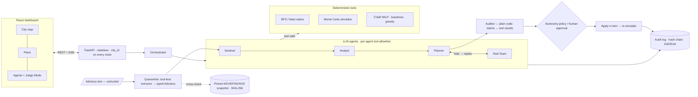

# Architecture

## Principles

1. **Agents decide, tools compute.** LLMs choose which tools to call and what to try; every number is a
   tool result with an ID.
2. **The checker is not an LLM.** The Auditor rejects any claim whose value differs from the recorded result.
3. **Untrusted text never reaches a planner.** Advisories become a typed `Advisory` in a tool-less call,
   are cross-checked against a pinned feed, and can only trigger re-scoring.
4. **Least privilege.** Each agent has an explicit tool allowlist; the Red-Team is read-only; only the
   approval path can apply a plan.
5. **Verify outcomes.** Plans are re-simulated without the linear approximation; the Red-Team attacks the
   chosen plan; results are reported on held-out scenarios.
6. **Deterministic and replayable.** Fixed seeds, cached LLM responses, `replay` mode for offline demos.

## Scaling

| Concern | Approach |
|---|---|
| Simulation | NumPy arrays (scenarios × devices), sparse adjacency, hop-wise spread |
| Optimisation | Scenario cap, greedy warm start, automatic MILP → greedy handoff (benchmark in EVALS.md) |
| Service | Stateless API, `city_id` on every route; SQLite → Postgres is a connection string |
| Events | Table-backed queue today; swappable for Redis/Kafka |
| Onboarding | Inventory import uses the same `Device` schema |

## Security model (OWASP Top 10 for LLM applications)

| Risk | Control |
|---|---|
| LLM01 Prompt injection | Quarantine + typed extraction + feed cross-check + no state-changing fields |
| LLM05 Improper output handling | Pydantic validation on every tool boundary; numbers only from tools |
| LLM06 Excessive agency | Allowlists, read-only Red-Team, human approval for anything with downtime |
| LLM09 Misinformation | Auditor rejects ungrounded claims; rejection rate reported |
| Repudiation / tampering | Hash-chained, signed audit log with a verify endpoint |
| Data poisoning | Feed snapshot pinned by SHA-256, refused if changed |
