# Architecture

```mermaid
flowchart LR
  subgraph UI[React dashboard]
    MAP[City map] --- PLANS[Plans] --- AG[Agents + Judge Mode]
  end
  UI <-- REST + SSE --> API[FastAPI · stateless · city_id on every route]
  API --> ORCH[Orchestrator]
  subgraph Agents[LLM agents · per-agent tool allowlists]
    SEN[Sentinel] --> ANA[Analyst] --> PLA[Planner]
    PLA <-->|hole → replan| RED[Red-Team]
  end
  ORCH --> Agents
  ADV[/Advisory text — untrusted/] --> Q[Quarantine: tool-less extractor → typed Advisory] --> SEN
  Q -. cross-check .-> FEED[(Pinned KEV/EPSS/NVD snapshot · SHA-256)]
  subgraph Tools[Deterministic tools]
    BFS[BFS / blast radius] ; SIM[Monte Carlo simulator] ; OPT[CVaR MILP · baselines · greedy]
  end
  Agents -->|tool calls| Tools
  PLA --> AUD[Auditor — plain code: claims ↔ tool results]
  AUD --> GATE{Autonomy policy / human approval}
  GATE --> APPLY[Apply in twin] --> SIGN[Compile + sign policy · control-plane Ed25519 key]
  SIGN --> ENF[Enforcer · deny-by-default gateway · verify key only]
  ENF --> VER[Corridor paths before → after · re-simulate] --> LOG[(Audit log · hash chain · Ed25519)]
  CMD[/Signal commands — untrusted/] --> ENF
  ENF -. every command .-> IL[Corridor interlock · plain-code safety rules]
  Agents --> LOG
```

## Principles

1. **Agents decide, tools compute.** LLMs choose which tools to call and what to try; every number is a
   tool result with an ID.
2. **The checker is not an LLM.** The Auditor rejects any claim whose value differs from the recorded result.
3. **Untrusted text never reaches a planner.** Advisories become a typed `Advisory` in a tool-less call,
   are cross-checked against a pinned feed, and can only trigger re-scoring.
4. **Least privilege.** Each agent has an explicit tool allowlist; the Red-Team is read-only; only the
   apply step can install policy (low-risk, no-downtime controls auto-apply; anything with downtime needs
   an approver), and there is no API route that pushes policy.
5. **Enforce, then verify.** Applied controls compile to concrete rules (deny flow, close management,
   rotate credentials, schedule firmware, filter CVE), signed with a control-plane key separate from the
   audit key. The Enforcer refuses a bad signature, another city's policy or an older version, then checks
   on its own flow table whether an internet-exposed device can still reach a corridor signal. Every signal
   command passes the corridor interlock, which judges the command, not the credentials.
6. **Verify outcomes.** Plans are re-simulated without the linear approximation; the Red-Team attacks the
   chosen plan; results are reported on held-out scenarios.
7. **Deterministic and replayable.** Fixed seeds, cached LLM responses, `replay` mode for offline demos.

## Scaling

| Concern | Approach |
|---|---|
| Simulation | NumPy arrays (scenarios × devices), sparse adjacency, hop-wise spread |
| Optimisation | Scenario cap, greedy warm start, automatic MILP → greedy handoff (benchmark in EVALS.md) |
| Service | Stateless API, `city_id` on every route; SQLite → Postgres is a connection string |
| Events | Table-backed queue today; swappable for Redis/Kafka |
| Onboarding | Inventory import uses the same `Device` schema |

## Security model (OWASP Top 10 for LLM applications)

| Risk | Control |
|---|---|
| LLM01 Prompt injection | Quarantine + typed extraction + feed cross-check + no state-changing fields |
| LLM05 Improper output handling | Pydantic validation on every tool boundary; numbers only from tools |
| LLM06 Excessive agency | Allowlists, read-only Red-Team, human approval for anything with downtime |
| Stolen operator credentials | Corridor interlock vetoes unsafe signal commands whoever sends them; closed management refuses remote ones |
| Rogue or replayed policy | Policy signed by a separate control-plane key; gateway holds only the verify key; no rollback to older versions |
| LLM09 Misinformation | Auditor rejects ungrounded claims; rejection rate reported |
| Repudiation / tampering | Hash-chained, signed audit log with a verify endpoint |
| Data poisoning | Feed snapshot pinned by SHA-256, refused if changed |
