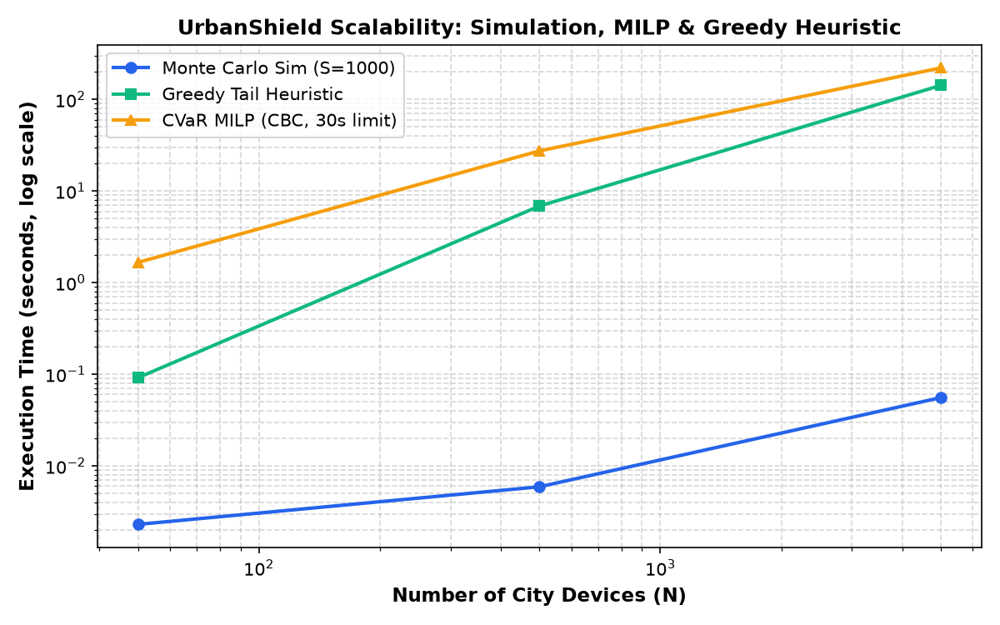

# Evaluation

_Generated by `backend/scripts/run_evals.py` (B) and the agent evidence scripts (C). Do not hand-edit numbers._

## 1. Plans under the same budget (held-out scenarios)

| Objective | Cost (INR) | Downtime (h) | Test CVaR (95%) | 95% Bootstrap CI | Mean Loss | Max Cascade | Solver | Time (ms) |
|---|---|---|---|---|---|---|---|---|
| **cvar** | ₹412,665 | 24.0h | **15.47** | [15.04, 15.92] | 10.23 | 26 | `milp` | 4632ms |
| **mean** | ₹410,716 | 24.0h | **15.34** | [14.97, 15.81] | 10.23 | 25 | `milp` | 124ms |
| **patch_only** | ₹268,321 | 24.0h | **19.83** | [19.39, 20.23] | 14.12 | 32 | `milp` | 499ms |
| **greedy_tail** | ₹400,386 | 24.0h | **15.40** | [14.99, 15.82] | 10.21 | 25 | `greedy` | 59ms |
| **cvss** | ₹362,855 | 24.0h | **15.74** | [15.30, 16.21] | 10.07 | 24 | `ranking` | 0ms |
| **cvss_kev_epss** | ₹365,336 | 24.0h | **14.32** | [13.92, 14.74] | 9.08 | 22 | `ranking` | 0ms |
| **loss_per_inr** | ₹350,471 | 24.0h | **13.99** | [13.54, 14.46] | 8.67 | 23 | `ranking` | 0ms |
| **bfs_centrality** | ₹375,304 | 24.0h | **14.94** | [14.49, 15.45] | 9.49 | 24 | `ranking` | 219ms |

### Headline Advantage (Same Budget: ₹600,000, Downtime: 24.0h)
- **Worst-case loss reduction vs CVSS-first:** **1.7%**
- **Worst-case loss reduction vs BFS-only:** **-3.5%**
- **Worst-case loss reduction vs Mean-Loss (Ablation):** **-0.8%**

## 2. Sensitivity (costs and criticality ±20%, 5 seeds)

| Seed | Perturbation | CVaR Plan Loss | CVSS Plan Loss | BFS Plan Loss | Mean Plan Loss | CVaR vs CVSS Gain | CVaR vs BFS Gain | Status |
|---|---|---|---|---|---|---|---|---|
| 11 | ±20% | 15.17 | 15.68 | 14.90 | 15.24 | **+3.2%** | **+-1.8%** | ⚠️ Regresses |
| 23 | ±20% | 16.18 | 16.51 | 15.72 | 15.95 | **+2.0%** | **+-2.9%** | ⚠️ Regresses |
| 42 | ±20% | 15.86 | 16.30 | 15.30 | 15.74 | **+2.7%** | **+-3.6%** | ⚠️ Regresses |
| 89 | ±20% | 15.63 | 16.11 | 15.18 | 15.59 | **+3.0%** | **+-3.0%** | ⚠️ Regresses |
| 137 | ±20% | 15.87 | 16.23 | 15.34 | 15.70 | **+2.2%** | **+-3.5%** | ⚠️ Regresses |

## 3. Red-Team vs random search (simulator calls to first hole, 20 seeds)

_pending_

## 4. Prompt-injection suite (≈50 variants incl. valid-but-wrong)

_pending_

## 5. Scalability (50 / 500 / 5,000 devices)

| Devices (N) | Scenarios (S) | Sim Time (s) | MILP Time (s) | Greedy Time (s) | MILP CVaR | Greedy CVaR | Gap (%) |
|---|---|---|---|---|---|---|---|
| 50 | 1,000 | 0.002s | 1.661s | 0.092s | 3.35 | 3.35 | **+0.06%** |
| 500 | 1,000 | 0.006s | 27.399s | 6.857s | 45.89 | 45.91 | **+0.03%** |
| 5,000 | 1,000 | 0.056s | 220.919s | 142.421s | 638.40 | 638.50 | **+0.02%** |

